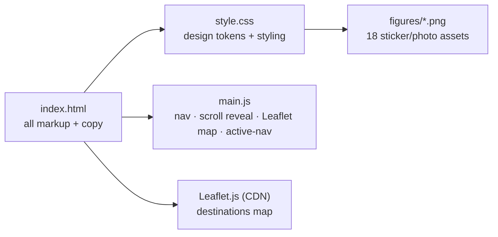

# dalat-2026 — Architecture

Da Lat trip website: a single static page (itinerary, crew, packing list, destinations map, food, memories placeholder) for ~10 friends. No backend.

## Stack



- **Static only** — no framework, no build-time templating, no server, no database.
- **Vite** is used purely as a dev server / bundler (`npm run dev|build|preview` in `frontend/`) — it does not add any routing or data layer.
- **Leaflet.js**, loaded via CDN `<script>`/`<link>` tags, powers the interactive pin map in the Destinations section.

## History — why there's no backend

An earlier plan (see prior versions of this file / `GEMINI.md`) explored a heavier stack: Astro 5 for static rendering, Svelte islands for live chat/confessions/a mini-game, and a dedicated Supabase project for auth, Postgres RLS, realtime, and storage, with an archive/export step so the site could keep working after Supabase's free tier paused post-trip.

That plan was **dropped**. The site is now the plain static page described above. The "Hòm thư tấu hài" (memories/confessions) section still exists in the copy as a nod to that original idea, but it is currently just a static empty-state card with no data behind it — nothing to redeem an invite code for, no realtime, no storage.

If a backend ever gets built again, treat that as a fresh design decision rather than resurrecting the old Supabase plan verbatim — re-evaluate against whatever the actual need is at that time.

## Directory Structure

```
dalat-2026/
├── frontend/
│   ├── index.html      # entire page content
│   ├── main.js          # nav toggle, IntersectionObserver reveal, Leaflet map, active-section nav
│   ├── style.css         # :root design tokens + all component styles
│   ├── figures/          # sticker + photo PNGs referenced by index.html/style.css
│   ├── package.json
│   └── package-lock.json
├── ARCHITECTURE.md       # this file
├── STICKER-PROMPTS.md    # style guide for generating new sticker assets
└── GEMINI.md             # dev guide — design tokens, motion, sticker stacking rules
```

## Deployment

Build output is static (`npm run build` in `frontend/` → `dist/`); deploy `dist/` to any static host (Netlify, Vercel, GitHub Pages, etc.) — no server-side runtime or environment variables required.
