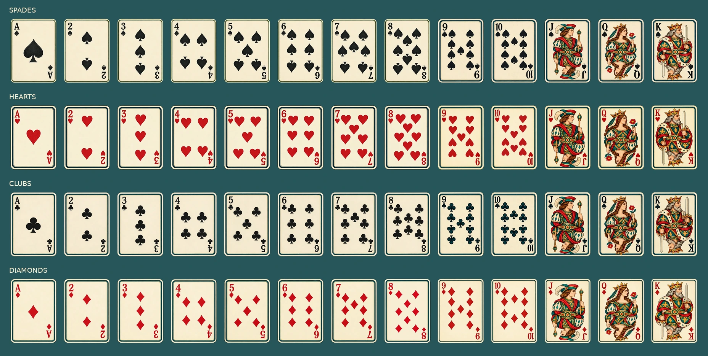

# Random-game artwork

[Documentation index](README.md) · [Visual identity](identity.md) · [Exact prompts](prompts/random_games/README.md)

Prepared on 16 October 2026 for coin flipping, dice rolling, standard playing-card draws, drawing sticks and a lottery bag. These are chance-based objects with no challenge or activity text. The existing wheel is retained. The website now integrates these objects in [Túi may mắn](games.md), alongside the original member wheel.


## Art direction

Match the existing wheel rim and painted coffee sticker: watercolor/gouache pigment, deep-teal pencil outlines, cream cloud curls, layered jade mountains and restrained sunrise peach/orange. The accepted coin sheet supplies an additional collection reference. All six returned PNGs have genuine alpha transparency. Existing project assets used as references remain unchanged.

Generation used the user's requested 9Router workflow, model `cx/gpt-image-2.5`, high quality, `background: transparent`, PNG output. Five component sheets are complemented by a separate blank playing-card front. The original scenic card front is retained as an optional decorative alternate.

## File ownership

| Path | Purpose |
| --- | --- |
| `figures/raw/random_games/*.png` | Six complete generated masters, preserved byte-for-byte |
| `figures/raw/random_games/generation.json` | Request metadata, reference hashes, timestamps and original hashes |
| `figures/decor/painted/games/*.webp` | 22 prepared transparent cutouts |
| `data/sources/game-artwork.json` | Generated provenance, measured crops, painted bounds, sizes and output hashes |
| `scripts/prepare_game_artwork.py` | Reproducible extraction and optimization |
| `docs/prompts/random_games/` | Six exact prompts and their index |
| `docs/research/games_artwork_preview.webp` | Generated review contact sheet, not a runtime asset |

## Component inventory

| Game | Files under `figures/decor/painted/games/` |
| --- | --- |
| Coin | `coin_sun.webp`, `coin_cloud.webp`, `coin_edge.webp` |
| Dice | `dice_one.webp` through `dice_six.webp`, `dice_tray.webp` |
| Cards | `card_back.webp`, `card_front.webp`, `card_front_scenic.webp`, `card_deck.webp` |
| Drawing sticks | `stick_long.webp`, `stick_short.webp`, `stick_sleeve.webp` |
| Lottery bag | `bag_closed.webp`, `bag_open.webp`, `ball_cream.webp`, `ball_jade.webp`, `ball_peach.webp` |

## Integration notes

- Paired coin faces share 512x512 canvases with 480x480 painted faces. Dice and lottery tokens share 256x256 canvases with 224x224 painted faces. Thin coin edge artwork is a separate component.
- Card back, blank front and scenic alternate share 416x640 canvases and 384x608 painted dimensions. Use `card_front.webp` for playing-card ranks/suits and unrestricted pip layouts. The scenic alternate intentionally has artwork along the bottom.
- Keep ranks, suit symbols, drawn numbers and names as live interface content. None are baked into the blank cards or lottery tokens. Standard dice pips are painted and have been visually checked for counts one through six.
- The long/short sticks share a 128x800 canvas, 72px painted width and 16px top anchor. The short stick's bottom has additional transparency. Align their full canvases and conceal lower ends behind the opaque sleeve; independently trimming them would lose the length relationship.
- Bags have separate closed/open artwork on equal canvases. Keep cords and openings visible. Store the game state separately from these decorative images.
- Preserve image aspect ratios. The manifest's `paintedBounds` describes where each object sits inside its transparent canvas. Images used beside an equivalent text label should be decorative.
- The picker loads small illustrations lazily; game panels request their artwork when first opened. The contact sheet and original PNG sheets are review/preparation material.

## Reproduce and verify

Use Python with Pillow, NumPy and SciPy installed, then run from `taxua-2026/`:

```sh
python scripts/prepare_game_artwork.py
```

The helper verifies all six original hashes before processing. It uses measured crops, keeps the largest connected alpha component at alpha >= 8, trims transparent margins, adds transparent padding and exports WebP at quality 92. Coin faces, dice faces, card rectangles and lottery tokens receive small geometry normalization while downsampling so paired objects align. There is no upscaling or recoloring. The original files and exact generation record are never rewritten.

Re-running regenerates the cutouts, manifest and contact sheet. Encoded bytes can depend on Pillow/libwebp versions. For runtime checks of actual card labels, motion fallbacks and keyboard equivalents, see [Games](games.md) and [Verification](verification.md).

## Original preparation verification

All six masters match the returned generated PNGs byte-for-byte, and every existing reference-image hash is unchanged. All 22 WebPs passed dimension, transparent-margin, hash and no-upscaling checks; regenerating them reproduced identical bytes in the preparation environment. Combined WebP size is 1,231,974 bytes. The preparation script parses, 63 local documentation links resolve, and the whitespace check passed. The complete contact sheet and small-size samples on light/dark backgrounds were visually reviewed. That initial asset-only phase left production HTML, CSS, JavaScript and trip content unchanged. The subsequent game integration is documented separately in [Games](games.md).

## Complete Sunburst playing-card deck · 17 October 2026



Every card face now has a generated image, including all aces and number cards. Eight sheets plus one corrected individual card from **9Router `cx/gpt-image-2.5-sunburst`** produce 52 distinct fronts with printed ranks, suits, conventional counted pips and reversible illustrated J/Q/K figures. Warm ivory paper, fine jade/gold borders and watercolor court textiles keep the deck within the journal palette. The shared court reference was also generated with Sunburst. The earlier 22 game assets and supplied originals remain unchanged.

| Path | Purpose |
| --- | --- |
| `figures/raw/card_courts/court_sheet.png` and `generation.json` | Shared generated court reference and request/hash record |
| `figures/raw/playing_cards/*.png` and `*.json` | Eight deck masters, the corrected eight of diamonds and exact request/hash records |
| `figures/decor/painted/games/deck/<suit>_<rank>.webp` | All 52 runtime fronts; suits are spades/hearts/clubs/diamonds, ranks ace through king |
| `data/sources/playing-cards.json` | All source/output hashes, actual crop rectangles and normalized dimensions |
| `scripts/prepare_playing_cards.py` | Reproducible extraction and WebP optimization |
| [Exact deck prompts](prompts/random_games/README.md#complete-illustrated-playing-card-deck) | Court reference and eight full-face requests |

Run `python3 -B scripts/prepare_playing_cards.py` from the site folder. The script verifies the Sunburst model and every source/reference hash, measures the actual disconnected card rectangles (generated gutters can drift), maps them in row-major order, substitutes the separately generated corrected eight of diamonds, verifies the central pip counts on all 40 ace/number cards and normalizes all cards to matching 5:7 printed dimensions on transparent 320×448 canvases without upscaling or recoloring. It writes only the 52 derived WebPs and their manifest.

`games.js` maps each existing card ID to its correct local suit/rank front. Full images load only when dealt. Accessible identities still come from game state and remain concealed until reveal. While an image loads, or when it fails, a code-rendered paper/rank/suit/pip fallback keeps the card playable. No runtime image-generation service, new library, altered deck composition or altered shuffle is involved. Both HTTP and direct-file use remain supported.

Run `node scripts/verify_cards.cjs` for all 52 mappings/decodes, correct fallback pips and colors, image failure, file opening and single-row responsive/enlarged-text layouts. Its rendered full-deck contact sheet and desktop/phone previews are written under `/tmp/taxua-cards-review` (`TRIP_REVIEW_DIR` overrides). Generated ranks, suit marks and pip counts also require visual review; an image decode alone cannot verify them.

Verification: all 52 distinct output hashes and transparent canvases match the manifest, all 40 ace/number images have their expected central pip counts, and the previous 22 game assets retain their original hashes. The full deck and desktop/phone layouts were visually reviewed. The focused card suite passed 76 checks; game and shared-control suites passed 206 and 96 checks respectively (378 total), with no uncaught browser errors. Browser evidence is in `/tmp/taxua-cards-review`, `/tmp/taxua-games-review` and `/tmp/taxua-controls-review`; this is Chromium emulation coverage.
