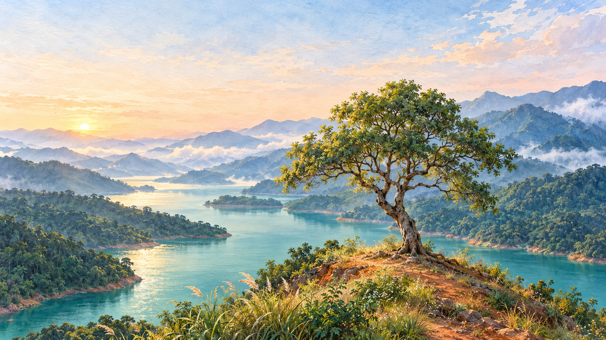
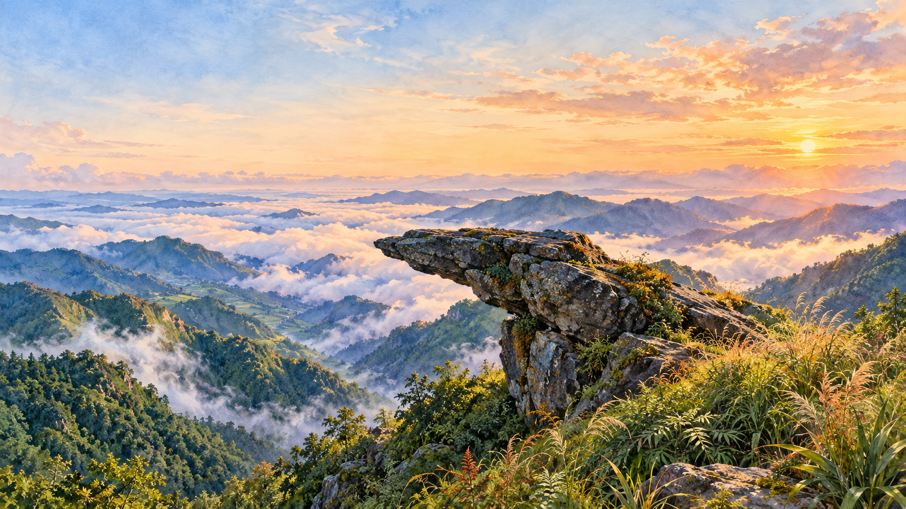
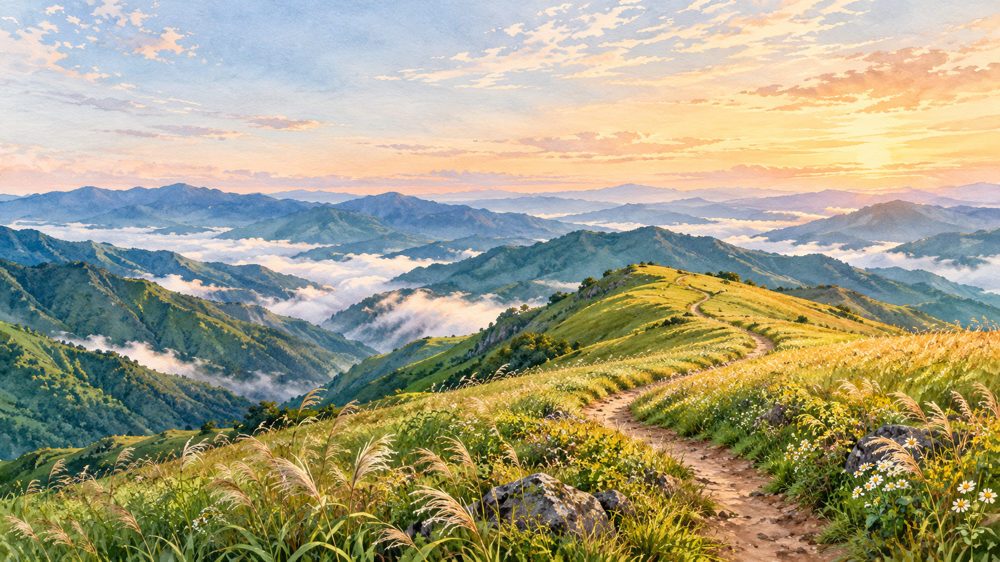
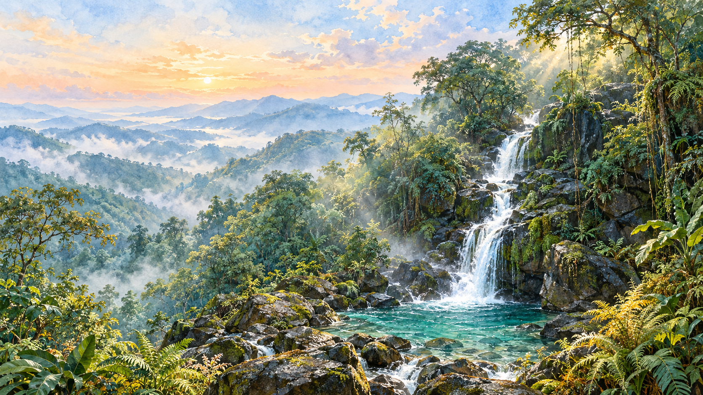
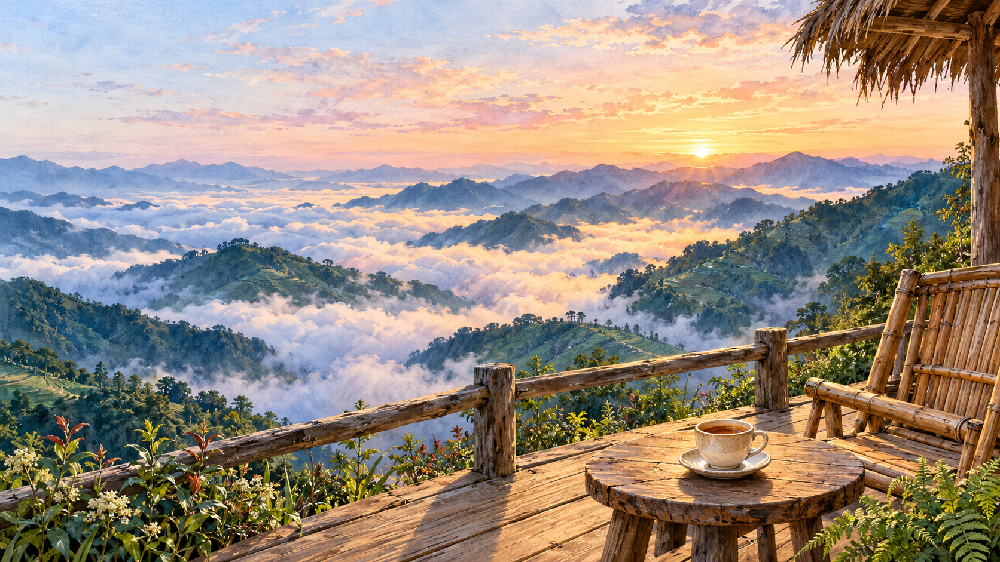
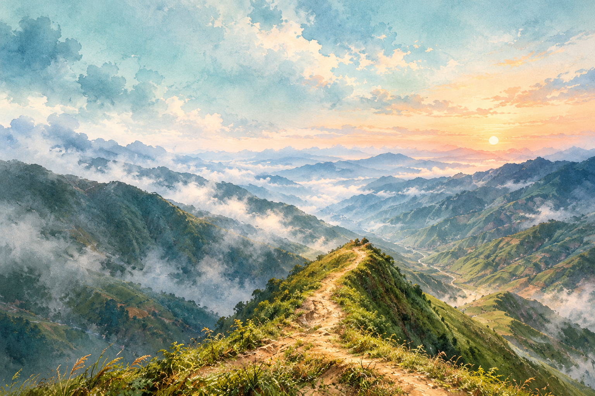

# Location artwork gallery

[Feature guide](location-scenes.md) · [Approved brief](location-scenes-plan.md)

All artwork below was generated with 9Router Sunburst. The five locations other than Sống Lưng, their stickers/foregrounds, and the shared effects were generated from written prompts alone, with no input images. Sống Lưng retains its approved artwork and original provenance. These are illustrations. Every returned master and its prompt/provenance JSON is preserved.

## Six desktop paintings

### Sống Lưng Khủng Long

[Portrait composition](../figures/scenery/locations/ridge_portrait.webp) · [Painted sticker](../figures/decor/painted/location_stickers/ridge.webp) · [Foreground / effect](../figures/scenery/locations/ridge_foreground.webp)

### Cây Cô Đơn

[Portrait composition](../figures/scenery/locations/tree_portrait.webp) · [Painted sticker](../figures/decor/painted/location_stickers/tree.webp) · [Foreground / effect](../figures/scenery/locations/tree_foreground.webp)

### Mỏm Cá Heo

[Portrait composition](../figures/scenery/locations/dolphin_portrait.webp) · [Painted sticker](../figures/decor/painted/location_stickers/dolphin.webp) · [Foreground / effect](../figures/scenery/locations/dolphin_foreground.webp)

### Thảo nguyên Tà Xùa

[Portrait composition](../figures/scenery/locations/meadow_portrait.webp) · [Painted sticker](../figures/decor/painted/location_stickers/meadow.webp) · [Foreground / effect](../figures/scenery/locations/meadow_foreground.webp)

### Thác Chua Tỳ

[Portrait composition](../figures/scenery/locations/waterfall_portrait.webp) · [Painted sticker](../figures/decor/painted/location_stickers/waterfall.webp) · [Foreground / effect](../figures/scenery/locations/waterfall_foreground.webp)

### Thào Coffee

[Portrait composition](../figures/scenery/locations/coffee_portrait.webp) · [Painted sticker](../figures/decor/painted/location_stickers/coffee.webp) · [Foreground / effect](../figures/scenery/locations/coffee_foreground.webp)

## Ridge art directions

Candidate B is used by the website. A and C are preserved alternatives.

### Candidate A: Peach sunrise and clouds

### Candidate B: Golden trail and wide jade valleys — selected

### Candidate C: Cool dawn and peach horizon

## Motion resources

[Bird silhouette](../figures/scenery/locations/birds.webp) · [Reservoir glints](../figures/scenery/locations/water_glints.webp) · [Waterfall spray](../figures/scenery/locations/spray.webp) · [Masked waterfall flow](../figures/scenery/locations/waterfall_flow_wide.webp)

A new prompt-only mist ribbon supplies the five refreshed scenes; Sống Lưng retains the original cloud ribbon. Rigid landmarks stay in the base paintings; the masked waterfall flow, steam, foliage and grasses move on separate bounded planes. Full native PNGs and JSON generation records are under `figures/raw/location_scenes/`; runtime WebP paths and hashes are in [the derivative manifest](../data/sources/location-scenes.json).

## Earlier desktop compositions

These photo-referenced paintings are historical and are no longer selected by the preparation script: [dolphin](../figures/raw/location_scenes/dolphin/wide.png), [waterfall](../figures/raw/location_scenes/waterfall/wide.png), [café](../figures/raw/location_scenes/coffee/wide.png).

## Prompt-only production records

[Exact generation jobs](prompts/location_scenes/text_only_jobs.json) · [Native PNG masters and provenance](../figures/raw/location_scenes/text_only/) · [Runtime source manifest](../data/sources/location-scenes.json)

Every current non-ridge master has an empty reference list. Wide and portrait paintings are exported losslessly at the native resolution returned by Sunburst.
