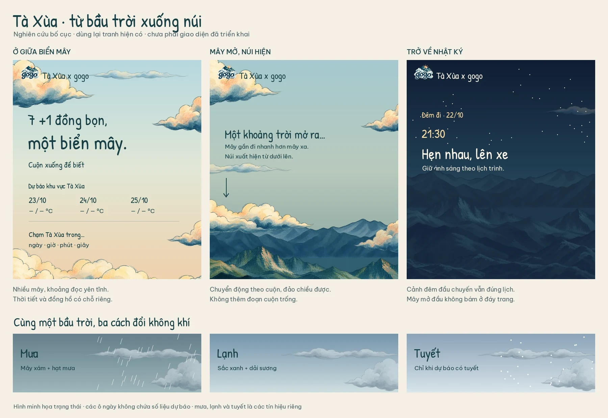

# Sky opening and trip-day weather: UI plan

[Documentation index](README.md) · [Scenery](scenery.md) · [Motion](motion.md) · [Generation brief](prompts/sky_weather.md) · [Research sources](sources.md#sky-and-weather-ui-research-15-october-2026)

Prepared on 15 October 2026 after inspecting the live page, current code, artwork and feature guides. **Implemented on 15 October 2026.** This document retains the original design reasoning and prototype targets; current behavior and ownership are described in [Sky and weather](weather.md). The documentation index was restored to `docs/README.md` during this audit.

The user confirmed that the front-page forecast should show **23, 24 and 25 October**, the three days in Tà Xùa. The evening departure from Hanoi on 22 October stays in the itinerary and date navigation.

## Recommended direction

Begin inside a generous, painted sky: large clouds around and between the page edges, pale blue/jade air, cream highlights and a peach horizon. Keep a calm opening around “7 +1 đồng bọn, một biển mây.” As the visitor scrolls, nearby clouds part and pass above the viewport while the existing mountain layers emerge from below. The itinerary then continues through its established six illustrated worlds.

Add a small handwritten weather composition to the hero. Hovering or focusing a date temporarily changes the sky, cloud character, temperature tint and precipitation. Clicking/tapping can hold that preview. Scrolling into the story restores its scheduled lighting. The weather strip should feel like an annotation in this journal.

Keep the current fonts, logo, Vietnamese copy, floating controls, 24 events, seven travelers, fund details, section order and native scrolling. Larger opening clouds are localized to the hero/transition; they clear away before the journal settles into its existing landscape. This implements the requested cloud-filled opening while preserving the rule against a persistent bottom cloud bank.

The storyboard is a spatial study. Final cloud shapes come from the generation brief, and final timing must be reviewed in a moving browser prototype. Its illustrated weather placeholders contain no forecast values.

## What the audit found

| Current behavior / evidence | Implication for this change |
| --- | --- |
| `scenery.js` composes six panels from CSS skies and transparent cutouts. Four full landscape paintings are reference art. | Extend the layered stage; keep the existing six world identities. A separate full-screen painting for every weather condition would make transitions and phone crops harder. |
| The opening uses one sky puff, one distant wisp and one low valley ribbon. The desktop is mostly orange sky with mountains already visible at its foot. | The requested feeling needs larger cloud masses and a different opening composition, beyond adding more copies of the small puff. |
| `JourneyScenery.drift(y)` is a small sine of scroll position. Nothing in that function advances with elapsed time. | Add time-based ambient motion independently of scroll-driven descent. |
| `motion.js` owns blends, fast-scroll catch-up, snapshots and navigation; `JourneyUI` supplies the native fallback. | Weather must not become another writer to the six panels' opacity or scheduled chapter metadata. |
| `sceneSnapshot()` clones the scene subtree for navigation/catch-up. | New loops must be frozen in snapshots. Precipitation should live outside the cloned subtree. Otherwise a jump could duplicate rain or keep old clouds moving. |
| Desktop countdown placement uses `left:calc(100% + 48px)` inside the hero copy. At 390×844, the countdown occupies roughly y=518–710; at 320px, the hero already grows taller than the screen. | Introduce an explicit hero summary layout. Inserting another absolute-positioned block risks overlaps. Allow natural phone height and reduce the clock's visual weight. |
| `#chapterWeather` is an editorial scene label such as “Trên biển mây”. It is not weather data. | Keep forecast data and preview status separate from that label. |
| No weather configuration, API client, condition mapping, cache or network states exist. | Add a small optional classic-script weather feature with explicit failure behavior. |
| The documentation index was at the site root, although its links and contributor rules expected `docs/README.md`. | Moving that existing file back into `docs/` repaired 25 missing local Markdown targets. |

### Baseline checks actually performed

- Inspected opening layouts at 1440×900, 390×844, 320×740 and 844×390: no horizontal overflow in those samples. Captured desktop/phone openings and their early transitions.
- All six existing scenery panels decoded with no failed cutout images. No browser console errors were reported in the sampled normal session.
- Sampled reduced-motion, missing-GSAP and direct-file modes: all 24 events remained rendered, with no page errors or horizontal overflow. Also checked the dawn resolver and centered breakfast reading position; the reduced-motion fallback displayed jade there.
- A browser `fetch` from the HTTP preview returned status 200 and all three trip dates from Open-Meteo. A second smoke request from direct-file viewing also returned 200.
- These are focused audit checks. The repository's full verification helpers, physical devices, Safari and Firefox were **not** run in this planning pass. Historical `review/` reports were not replaced.

## 1. Opening composition and descent

### Layer arrangement

Use the existing CSS sky and terrain assets with four new opening cloud components. Arrange clouds across top corners, side edges and the lower transition area, with different depths and unequal shapes. Keep a deliberate reading opening through the center-left title and the right summary.

The visual depth order is: sky → distant wisps/cloud sea → far ridge → mid ridge → near ridge → passing near clouds → decorative weather → page content. Clouds can overlap terrain during descent. They must not cover the title, weather numbers, countdown or navigation.

| Opening progress | Composition | Motion |
| --- | --- | --- |
| Initial view | Mostly sky and generous clouds; terrain below the visible frame or almost entirely obscured | Slow cloud drift; one small coffee/cloud sticker gesture |
| Early descent | Distant clouds begin to separate; a faint ridge becomes visible low in the frame | Far clouds move gently; near clouds travel farther toward the top/outer edges |
| Late descent | The cloud layer opens onto the existing layered mountains | Near terrain rises into framing faster than distant terrain; cloud ribbons pass and fade |
| First itinerary reading position | Familiar mountain composition; opening clouds have cleared | Existing night/road scene continues, followed by the current chapter transitions |

This is a change in apparent altitude, independently of the change in lighting. The first itinerary event is the **night departure**; the opening must still reach that scene. Do not substitute a sunny itinerary or alter source times to simplify the transition.

### Scroll implementation

- Measure the hero, its lowest essential content and the first itinerary reading position after fonts/layout settle. Map that existing distance to a normalized opening progress; avoid fixed pixel milestones and extra spacer sections.
- Feed that progress from the existing motion controller. Let the native fallback compute the same composition endpoint without parallax when motion is reduced or GSAP is unavailable.
- Move nested depth wrappers with `transform`. Retain the current ridge framing and fill geometry underneath them. Avoid animating ridge `bottom`, image dimensions or page padding on each frame.
- Separate wrapper transforms: opening descent on an outer wrapper, existing scroll drift on another, elapsed-time cloud drift on the inner image. This prevents three features overwriting the same `transform`.
- Start revealing mountains below the lowest visible hero controls. Delay dark lighting until the dark hero copy has cleared. Recalculate this boundary after the new summary layout settles; the current hero-height approximation is insufficient for taller phones.
- Reverse scrolling must retrace the same cloud opening and terrain reveal. Fast flings and direct links should land in the correct composition immediately, then use the existing catch-up dissolve.
- Keep native wheel/touch behavior, existing anchors, current compact story spacing and the no-pinning rule.

## 2. Hero components and responsive layout

| Component | Presentation and behavior |
| --- | --- |
| Primary hero copy | Preserve the date, 7+1 headline, subtitle and discoverable itinerary action. Keep the title stationary while the environment moves. |
| Hero summary | Use a real grid area alongside the copy on desktop. Put the forecast first and a quieter arrival countdown below it. Remove reliance on the clock's current absolute offset. |
| Three-day forecast | Three native buttons, one each for 23/10, 24/10, 25/10. Each shows a weather icon, low–high temperature, short Vietnamese condition and precipitation probability when available. Use open spacing and pencil separators. |
| Forecast detail/status | A reserved line below the dates shows the selected date, daily summary, wind/gust information and freshness. The initial instruction can be “Chạm hoặc rê chuột để xem trời từng ngày.” |
| Preview reset | A small visible “Trời ban đầu” action when a preview is held. Escape clears a held preview too. |
| Motion control | A compact accessible “Dừng chuyển động” / “Bật chuyển động” control for decorative loops. Keep the forecast usable while paused. |
| Loading/unavailable state | Reserve the same three-date footprint before the request. Use dashes and a short status; there must be no invented temperatures or layout jump. |

On phones, use natural document flow: primary copy/action → forecast → compact countdown. Keep the three dates in one row where readable, with at least 44px interaction targets; shorten secondary labels before shrinking type. At 320px, wrap supplemental wind/freshness details below the row. A slightly taller content-filled hero is acceptable; an empty scroll runway is not.

Keep weather selection distinct from the existing itinerary date navigation. Weather buttons preview; date-navigation anchors travel. Selecting forecast weather must not unexpectedly scroll the visitor away.

Maintain a quiet text backdrop through composition and local contrast treatment. Review every weather palette for title, forecast, countdown and navigation contrast. A storm palette may require a separate hero ink token; the current `setSceneryTone('sunrise')` alone cannot decide that.

## 3. Motion vocabulary

These are starting values for prototyping, not measured performance results.

| Element | Proposed motion |
| --- | --- |
| Distant wisps | 75–120 second shallow drift, roughly 12–28px |
| Middle cloud masses | 45–90 second drift, roughly 25–60px; different phases |
| Near clouds | 35–65 second gentle travel, plus the larger scroll-driven exit |
| Selected stickers | 2–5px bob and 1–2° rock over 6–10 seconds; at most one or two at once |
| Weather change | Cancellable 600–900ms sky/cloud/precipitation blend; immediate or nearly immediate under reduced motion |
| Rain | Two small seeded SVG/CSS streak fields, translated behind content, with restrained density |
| Snow | A sparse local SVG/CSS flake field only for a snow forecast; slower motion than rain |

Start with approximately 6–9 cloud instances on desktop and 4–6 on phones. Reuse decoded textures with different positions and depth; do not multiply full-screen images. Keep terrain steady while idle so the reader feels on stable ground.

Animate `transform` and `opacity` where possible. Use static gradients with crossfaded layers rather than continuously animating full-screen gradient stops or filters. Avoid per-frame layout reads, heavy blur/displacement and a DOM node for every raindrop. A particle library, WebGL, background video or Lottie is unnecessary for this scope.

Only visible outgoing/incoming scene panels should run ambient loops. Pause in hidden tabs. Freeze loops in cloned navigation snapshots and cancel stale preview fades. The motion control stops decorative cloud/sticker/precipitation loops; reduced-motion mode also removes parallax and preserves static weather information. Countdown values stay truthful even when its number-transition effect is disabled.

## 4. Open-Meteo integration

### Location and request

Use an explicit destination location, independent of the visitor's location. Research identified **21.27516 N, 104.43396 E** for Tà Xùa, Bắc Yên, Sơn La. This is a suitable regional starting point, rather than a claim about the exact homestay or the separate high summit. Check the intended stay pin when implementing; leave automatic elevation downscaling enabled unless a verified site elevation justifies an override.

The live request returned a model cell at 21.335676, 104.40367 and elevation 1,538m. This reinforces the product label **“Dự báo khu vực Tà Xùa”** and the caveat that ridge/valley conditions vary. Do not advertise exact lookout conditions or a guaranteed cloud sea.

Use ordinary browser `fetch` against `/v1/forecast`, with `timezone=Asia/Ho_Chi_Minh`, Celsius and km/h. No SDK, API key or backend is needed for this personal non-commercial site. Weather is an optional network enhancement; the journal remains local and readable if the request fails.

| Daily field | Use |
| --- | --- |
| `weather_code` | Vietnamese label, icon and principal weather preset |
| `temperature_2m_min`, `temperature_2m_max` | The visible low–high range |
| `apparent_temperature_min` | Optional cold-feel styling/detail, clearly referring to the day's coldest apparent temperature |
| `precipitation_probability_max` | Highest precipitation probability; use an appropriate rain/snow label |
| `precipitation_sum`, `snowfall_sum` | Summary amounts and support for interpreting precipitation type |
| `wind_speed_10m_max`, `wind_gusts_10m_max` | Wind detail and a capped drift-speed accent |
| `sunrise`, `sunset` | Optional concise daily detail; never replace the scheduled arrival countdown |

The documentation describes the daily weather code as the most severe condition that day. Therefore label the background preview **“Minh họa thời tiết nổi bật trong ngày”**. A rainy daily summary does not mean it will rain continuously, or during the planned dawn outing.

For v1, daily data is enough. A later explicit “Sáng sớm 05–08h” view could add hourly weather, apparent temperature, cloud cover, wind and visibility. That would need its own time label and null handling. Do not manufacture a “cloud-hunting probability” from humidity/cloud-cover alone.

### Forecast dates and lifetime

- Derive the three mountain dates from `TRIP_DATA.days`, starting with the day containing `arrival`. Keep API settings and Vietnamese copy in a new `TRIP_DATA.weather` configuration; avoid duplicating schedule dates in another script.
- Compute today's date in Vietnam, even if the visitor is overseas. Compare returned ISO calendar dates directly; do not parse date-only strings as UTC instants and format them back in the visitor's timezone.
- Request the intersection of the trip dates with today through today+15 days using `start_date` / `end_date`. The normal API supports up to 16 days. All three dates were available in the 15 October smoke check.
- Before a date enters the horizon, keep its button visible with “Chưa có dự báo ngày này” and no active effect. Handle partial availability date by date.
- After a date passes, label it “Ngày đã qua”. Do not present an old forecast as an observation. After the trip, keep the journal opening and stop requesting unrelated rolling forecasts. Historical weather can be a separate later feature.
- Distant forecasts should carry concise “Dự báo xa ngày, còn có thể thay đổi” copy. Do not attach a fabricated numerical confidence score.

### Request, cache and failure policy

Fetch once for the available date range and cache normalized data for one hour. Date hover/focus/click must read memory and make **zero** network requests. Store a versioned key including destination coordinates, timezone, fields and dates; tolerate denied storage by keeping an in-memory cache.

Use an approximately 8-second timeout, HTTP/shape validation and finite-number checks. Match arrays by returned dates; preserve `null` as unavailable. Never coerce missing temperatures to 0°C or an unknown weather code to clear sky. Use a request generation/abort guard so older responses cannot replace newer state.

Refresh on a new visit or return to a visible page only when the cache is expired. Offer a retry with a short cooldown; avoid continuous polling. A cache up to 24 hours old can be shown with a clear saved-data timestamp after a failed refresh. Older cache should give way to the unavailable state and default sky. Keep time-range eligibility checks even for cached data.

Show a small provider attribution beside the forecast, linked as described in [research sources](sources.md#sky-and-weather-ui-research-15-october-2026). Label the client timestamp “Lấy dự báo lúc …”; `generationtime_ms` is request computation time, not a forecast issue timestamp. The free endpoint has non-commercial usage limits; this small, cached feature fits its intended use.

## 5. Weather-to-background rules

Condition and temperature are separate inputs. The same rainy day may also be cold; apply its rain layer and a restrained cool tint together.

| Data / condition | Visual treatment |
| --- | --- |
| WMO 0–1: clear/mainly clear | Spacious sky, cream clouds, warm light; keep the requested cloud-journal identity |
| WMO 2: partly cloudy | More passing clouds and intermittent sun occlusion |
| WMO 3: overcast | Slate/jade sky, heavier cloud masses, subdued sun |
| WMO 45/48: fog/rime fog | Local mist ribbons, lower distant-ridge contrast; rime fog is not falling snow |
| WMO 51/53/55: drizzle | Fine, sparse rain with soft overcast light |
| WMO 61/63/65, 80/81/82: rain/showers | Capped rain density and slate clouds; severity affects intensity |
| WMO 56/57, 66/67: freezing precipitation | Cold rain treatment and an accurate label; do not substitute snowflakes |
| WMO 71/73/75/77, 85/86: snow | Sparse falling flakes and cool clouds; no automatic snow-covered mountains |
| WMO 95/96/99: thunderstorm / hail | Darker cloud depth and rain; quiet weather imagery without lightning flashes |
| Cold apparent minimum | Gradually cooler light and localized cold mist, independently of precipitation |
| Windy day | Slightly quicker lateral cloud travel, with a strict speed cap |
| Missing/unknown code | Neutral cloudy preview if useful data exists; otherwise the normal opening, with unavailable text |

Start the cold accent around an apparent minimum below 12–14°C and increase it gradually; those are tunable art-direction thresholds. **Cold temperature alone must never trigger falling snow.** Use the snow condition codes, or an explicitly positive snowfall forecast with missing condition data. Daily snowfall also does not establish persistent ground cover.

Rain probability alone is not rain intensity. Use the condition code for the main effect, and keep probability in the text. Avoid an all-day deluge simply because one hour has a high precipitation chance.

### Interaction contract

| Input/state | Result |
| --- | --- |
| Initial load | Default cloud-filled opening; factual weather strip loads independently |
| Fine-pointer hover, after a small intent delay | Temporary day preview; moving between days retargets the current blend |
| Keyboard focus on a date | Equivalent temporary preview with a visible focus ring |
| Click / Enter / Space / phone tap | Hold that date using a native button with `aria-pressed`; activate again to clear |
| Pointer leaves the group / focus leaves it | Return to the held date, if any; otherwise restore the default sky |
| Reset action or Escape | Clear the held/temporary preview and restore the opening |
| Scroll beyond the hero | Fade preview weight to zero, clear the hold and let the story own lighting; do not move keyboard focus |
| Deep-link load into the itinerary | No opening weather override; load and show the correct story scene |
| Reduced motion / decorative motion paused | Same forecast and selection, static or minimal weather treatment |

Resolve temporary preview priority as focused date → hovered date → held date → no preview. Make the reset action explicit so touch users can always return to the opening. Pointer-generated focus must not prevent another date's hover from working; distinguish keyboard-visible focus from pointer focus in that priority.

Keep a small exit delay when moving between buttons, and cancel all delayed enter/leave work on reset or hero exit. New preview requests should replace old tweens; never queue them. Decorative layers are `aria-hidden` and `pointer-events:none`. Use a restrained status announcement on committed selection/load/error, without announcing each particle, hover or countdown tick.

## 6. Code ownership and integration boundaries

Names below are proposed interfaces, not existing implementations.

| File | Planned responsibility |
| --- | --- |
| `data.js` | Destination/API settings, enabled trip-day policy and weather UI copy |
| `index.html` | Semantic hero summary, weather placeholder, motion control; local stylesheet/script references |
| `style.css`, `countdown.css` | Intentional hero grid and compact phone countdown; consolidate affected existing overrides |
| `scenery.js` | Opening cloud composition, `setOpeningProgress()`, `setWeatherPreview()`, active-panel ambient lifecycle and snapshot-freezing support |
| `scenery.css` | Cloud/ridge depth wrappers, sky/temperature palettes, ambient motion and static fallbacks |
| New `weather.js` | Optional classic-script client: dates, fetch/cache, normalization, WMO labels, input state and reset/hero-exit handling |
| New `weather.css` | Forecast composition, preview-state detail, weather fields and accessible motion-control styling |
| `scripts/prepare_icons.cjs` | Add the required official Lucide weather symbols to the local inline sprite; retain the preparation-only library/license workflow |
| `main.js` / `JourneyUI` | Preserve chapter/date/sticker behavior; share opening-state updates with the native fallback |
| `motion.js` | Supply enhanced opening progress, preserve scene blends/navigation, freeze new animated layers in snapshots and clear preview before story travel |
| `scene-config.js` | Retain the six worlds and chapter mapping; add only small opening/visual configuration if it reduces duplicated constants |
| `scripts/prepare_illustrated_scenery.py` and source manifest | Import new artwork, create optimized alpha-preserving derivatives and record provenance |

Preserve the current eight-script order. Append the optional `weather.js` after `motion.js`, so the current content/background boot still completes independently. Load `weather.css` after the existing visual styles, with narrowly scoped selectors. No modules, new runtime package, CDN or backend.

Keep one owner per state:

- The existing story controller owns the six base panels' opacity, chapter phase, date rail and scheduled sticker periods.
- Opening progress owns cloud separation and terrain reveal. It is based on scroll position, not selected weather or the wall clock.
- Weather owns only its preview sky/cloud accents, precipitation, temperature treatment and hero contrast token. It never calls `setChapter()` or rewrites event metadata.
- Ambient motion owns small elapsed-time movement on inner wrappers. It never replaces scroll transforms or animates frozen snapshots.

Place precipitation outside the subtree cloned by `sceneSnapshot()`. If opening sky/cloud nodes are inside that subtree, freeze their computed transforms and weather blend weights when cloning; prevent inherited live variables or CSS keyframes from changing the snapshot afterward. On distant travel, clear the live preview, retain one stable outgoing composition and dissolve directly to the destination. Repeated flings must not accumulate nodes, loops or listeners.

The API is an explicitly optional external data source. Update the relevant contributor/architecture wording when implementing so “all runtime assets are local” still describes artwork/libraries, while forecast data is fetched on demand. Keep direct-file viewing and network-failure fallback usable.

## 7. Artwork: reuse and generation

### Reuse first

| Existing asset | Inspected native dimensions | Proposed use |
| --- | --- | --- |
| `cloud_sky_puff.webp` | 815×305 | Middle-distance accent, never stretched across the entire screen |
| `cloud_distant_wisp.webp` | 1393×147 | Fine, far cloud movement |
| `cloud_valley_ribbon.webp` | 1482×320 | Local valley mist and prototype cloud separation |
| `ridge_far`, `ridge_mid`, `ridge_near` | 2172×330 / 475 / 451 | Existing ground reveal; retain night/bluehour derivatives |
| Serrated ridge, meadows, tree, lake, hut | Existing transparent cutouts | Existing six story worlds remain intact |
| Sun, moon, stars and grain | Existing pieces | Reuse with weather-aware occlusion/intensity |
| Coffee, bus, backpack, headlamp stickers | Existing painted cutouts | A few purposeful ambient gestures |

The two older small day-cloud stickers have thick sticker outlines. Use those as foreground journal accents, not the main distant atmosphere. The painted scenery clouds fit the landscape better.

### Minimum new pack: five individual cloud images

| Planned name | Desired source composition | Purpose / priority |
| --- | --- | --- |
| `cloud_hero_left` | Large asymmetric cloud cluster; about 2:1, target 2048×1024 or larger native output | Close left/top framing; core |
| `cloud_hero_right` | Different asymmetric cluster; about 2:1, target 2048×1024 or larger native output | Close right framing; core, not a mirrored duplicate |
| `cloud_sea_far` | Wide, shallow cloud layer; about 3:1, target 3072×1024 native | Suggest depth and reveal the far ridge; core |
| `cloud_transition_near` | Wide billowing, irregular cloud ribbon; about 3:1, target 3072×1024 native | Brief nearby cloud passage during descent; core |
| `cloud_overcast` | Cool slate/cream cloud cluster; about 2:1, target 2048×1024 native | Give rain/overcast a distinct painted shape; weather polish |

Requested dimensions express an intended useful resolution, not a reason to upscale an output. Request the highest supported native size, record the actual size and adjust the layout accordingly. Large cloud components should be generated individually so sheet crops do not waste most of the available pixels.

Optional later work: one small umbrella/scarf/wind-ribbon sticker sheet, and one desktop/one phone composition reference. The references can establish framing but should not become runtime wallpapers. Rain, snow particles and tint transitions can be authored locally as SVG/CSS; add official weather icons through the existing Lucide sprite preparation script. None of these needs image generation. No mountain or logo regeneration is required for v1.

The [generation brief](prompts/sky_weather.md) provides the shared style and five component prompts. Preserve current masters and introduce new named originals. Extend the existing pipeline and manifest; do not overwrite the current `cloud_sheet.png`, change its measured crop coordinates casually or rebuild `assets.js` for decorative artwork.

Keep genuine alpha, fine pigment edges and empty padding. Review every cutout on cream, jade and dark indigo before accepting it. Produce phone/desktop derivatives capped at native resolution. An overcast/cold palette derivative may reuse painted geometry through the existing offline color-variant approach; avoid runtime grayscale filters that destroy the watercolor colors.

## 8. Performance and fallback targets

Treat these as budgets to verify in the prototype:

- Aim for additional initial cloud downloads below about **450 KiB on phones / 700 KiB on desktop**, using responsive derivatives and no unnecessary full-resolution PNG downloads. Adjust the pack if the painted alpha textures exceed that budget.
- Preload only the essential opening pieces. Decode incoming weather/cloud art before blending; retain the current readable sky while it loads. Do not decode every optional weather variant at startup.
- Run ambient loops only for visible layers, with at most the outgoing/incoming story panels and one bounded weather transition active. Prefer shared precipitation textures over many particle elements.
- Verify no sustained animation-driven layout work, no growing snapshot count, no listener growth after resize/reduced-motion toggles, and no weather-induced layout shift.
- Aim for smooth motion on a midrange phone, then measure with browser performance tools and a real device. No frame-rate or battery claim has been established by this plan.
- Missing network/storage/images/GSAP must retain the story, forecast dates and honest status text. Print should expose content without clouds or particles; do not put an unlabelled, stale forecast into `itinerary.html`.

## 9. Delivery sequence

1. **Establish the composition with existing art.** Implement the hero grid and reserved three-day strip using explicit development fixtures. Prototype opening progress with reused clouds. Inspect desktop/phone stills and forward/reverse scroll before commissioning replacements.
2. **Generate and integrate the targeted pack.** Start with the four opening clouds; add the overcast cluster after the opening works. Preserve originals, document provenance and check light/dark alpha edges. Inspect the actual phone crop and transition seams.
3. **Implement reliable weather.** Add the optional client, real three-day request, normalized state, cache, timeout and all unavailable/after-trip states. Connect forecast text and icons before attaching animation. Confirm public HTTP and direct-file behavior.
4. **Connect previews and ambient motion.** Add cancellable hover/focus/tap effects, cold/rain/snow rules, pause/reduced-motion behavior, snapshot freezing and story handoff. Keep the effect modest until the reading layout is stable.
5. **Verify and document.** Run the focused existing helpers and new deterministic weather coverage. Update scenery, motion, group, source and verification guides to describe implemented behavior, then capture new evidence in a clearly dated location.

Each step should be a small reviewable change. The first useful visual checkpoint is the cloud-filled opening and one complete descent; the first useful data checkpoint is the real three-day strip with the API offline.

## 10. Acceptance checks for implementation

| Area | Required evidence |
| --- | --- |
| Opening | At the top, clouds create depth and terrain is hidden/mostly obscured; title, action, weather and countdown remain readable. At the first itinerary reading position, terrain is established and the scheduled night scene is correct. |
| Reversibility | Equal forward/reverse scroll positions reproduce the same opening composition. Pausing halfway holds it. A fling, anchor jump, interrupted journey and deep-link reload leave no stuck veil. |
| Weather truth | Only 23–25 October are shown; timezone is Vietnam; min/max and probability match the response; null/unknown values stay unavailable. Cold-clear never produces snow. Freezing rain, fog and snow are distinguished. |
| Input | Hover, keyboard focus, Enter/Space, touch selection, reset and Escape work. Rapid switching changes no request count and leaves one current preview. Selected weather never changes the date-navigation hash. |
| Hero exit | Hover then scroll, pinned preview then anchor, reset during a fade, late image decode and late fetch completion all return control to the current story scene. |
| Resilience | Timeout, 400/429/500, offline, partial dates, far-future/past trip, denied storage, corrupt cache and missing optional images produce useful states. Cached forecast is never labelled observed weather. |
| Motion | Pause, hidden tabs, preference changes and missing GSAP stop/avoid the appropriate motion; static weather remains usable. Snapshot clones contain no running loops or duplicated precipitation. |
| Layout | Inspect 1440×900, 390×844, 320px narrow, tablet, 2560px wide and short landscape. No overflow, forecast/clock overlap, obscured focus ring or date-rail collision. |
| Existing features | Retain 24 events/18 guides, source details/captions, arrival target, menu/notes/decks/packing, exact fund details and section order. |

Use network interception and fixed clocks for a new `scripts/verify_weather.cjs`; cover mapping, date eligibility, stale cache and preview races without relying on a changing live forecast. Use a separate review harness to inspect clear, cold, rain and snow fixtures even when the real three days have similar weather; keep that fixture selector out of the trip page. Include one separate real API smoke check. Keep the implementation tests meaningful: verify user-visible outcomes and ownership boundaries rather than duplicating formulas.

After scenery/layout changes, run `verify_illustrated_scenery.cjs`, `verify_motion.cjs`, `verify_reveals.cjs` and `verify_countdown.cjs`; use `verify_journey.cjs` for native controls/content regression. Keep fixed source counts and the six-world contract. Adapt sampling to each component's reading position if necessary, rather than assuming a short event always owns the viewport when its top is scrolled above the screen. Other focused helpers are needed only if their owned behavior changes.

Run JavaScript syntax and documentation-link checks. Regenerate the reading copy only if exported trip content changes. Report actual results and keep any unrun device/browser coverage explicit.
