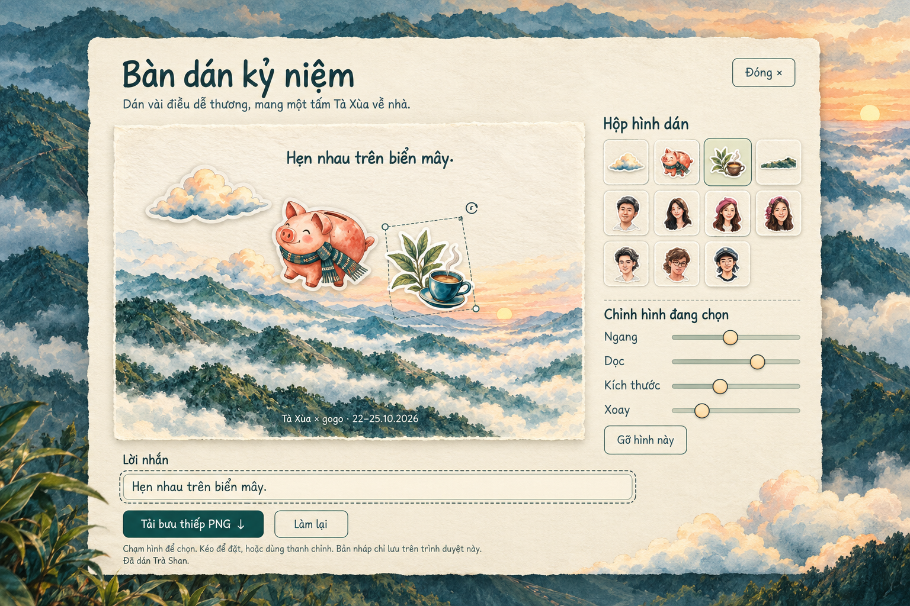
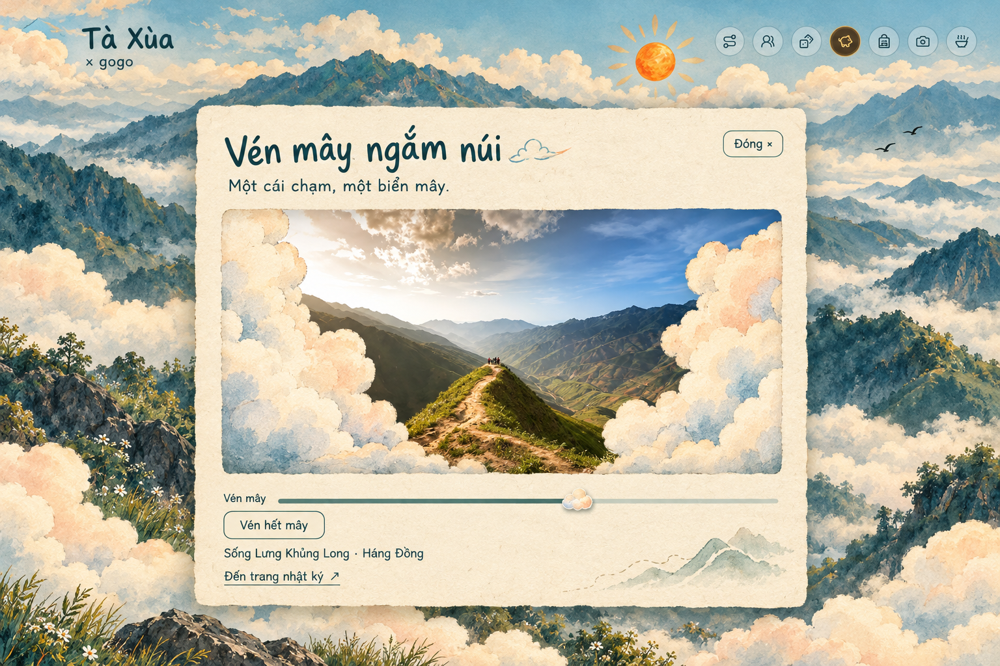
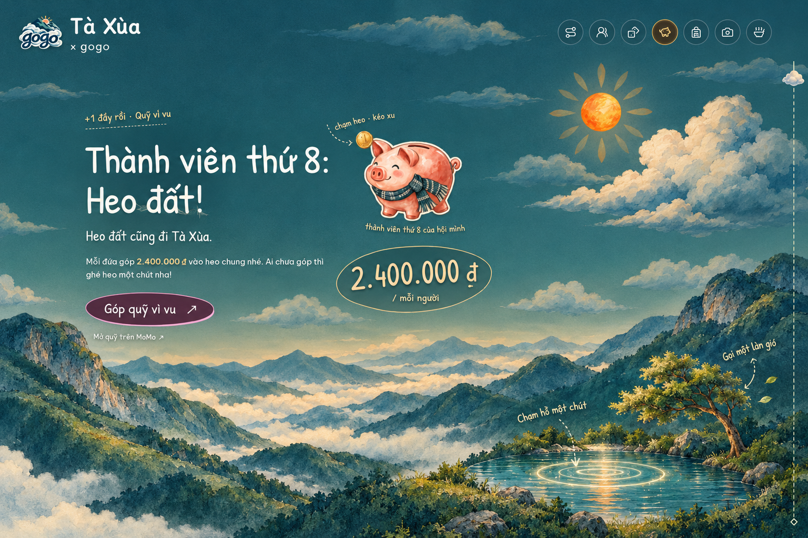

# Three playful UI concepts

[Documentation index](README.md) · [Retired implementation record](research/retired-keepsakes.md) · [Scenery interactions](playful.md)

Fresh Sunburst mockups regenerated on **19 October 2026**, using current-site screenshots as image references. The previous temporary images are unavailable, so these are new interpretations of the same three concepts. They are **generated review illustrations**, not screenshots proving implemented behavior. The features illustrated here were removed at the user’s request on 19 October 2026. These retained images are historical concepts and are not loaded by the website.

## Postcard sticker studio · Bàn dán kỷ niệm

[Full PNG](../figures/raw/ui_concepts/01_ban_dan_ky_niem.png) · [Exact prompt](prompts/ui_concepts/01_ban_dan_ky_niem.txt) · [Generation record](../figures/raw/ui_concepts/01_ban_dan_ky_niem.json)

An optional paper workbench for arranging the existing pig, clouds, tea, mountains and traveler stickers into a small keepsake. A caption and PNG export complete the physical postcard metaphor. Keep accessible position/size/rotation controls alongside any drag interaction. Public artwork belongs here; private diary material stays separate.

## Cloud reveal · Vén mây ngắm núi

[Full PNG](../figures/raw/ui_concepts/02_ven_may.png) · [Exact prompt](prompts/ui_concepts/02_ven_may.txt) · [Generation record](../figures/raw/ui_concepts/02_ven_may.json)

Part two painted clouds to discover a destination photograph inside a small story object. Provide a slider and a one-tap reveal, preserving the photo credit and story link. The concept uses the supplied ridge photo as an image reference, but generated image details are not documentary evidence.

## Lake and tree · Chạm hồ, rung cây

[Full PNG](../figures/raw/ui_concepts/03_cham_ho_rung_cay.png) · [Exact prompt](prompts/ui_concepts/03_cham_ho_rung_cay.txt) · [Generation record](../figures/raw/ui_concepts/03_cham_ho_rung_cay.json)

Small ripples and a brief tree sway make the illustrated world respond to touch. Scenery may be enlarged in this still concept to explain the action; the actual site keeps these discoveries at its edges, clear of text and controls. Respect pause and reduced motion, with static feedback when movement is disabled.

## Rationale and ownership

The proposed sequence was **lake/tree → postcard studio → cloud reveal**. Lake/tree reuse the smallest existing scenery surfaces; the studio adds the most substantial new activity; cloud reveal provides a quieter photo discovery. The later implementations have since been removed at the user’s request. The replacement direction is the [location-scene plan](location-scenes-plan.md), which has not been implemented.

The research rationale favors familiar physical gestures and feedback attached closely to the activated object. Paper Planes illustrates the keepsake metaphor; NN/g discusses contextual microinteractions. W3C guidance requires alternatives to dragging and control over nonessential interaction animation. Links are collected in [Sources](sources.md#playful-ui-concept-references).

- Former lake/tree reactions lived in `playful.js` / `playful.css`; those additions are removed.
- Former `keepsakes.js` / `keepsakes.css` workspaces and their focused verification helper are removed.
- `scenery.js`: existing decorative stage; no new scene or weather ownership in these concepts.
- `figures/raw/ui_concepts/`: full returned PNGs, per-image provenance and actual screenshot references.
- `docs/prompts/ui_concepts/`: exact text prompts.

Model: **9Router `cx/gpt-image-2.5-sunburst`**, high quality, requested 1536 × 1024 PNG. Each generation record stores actual dimensions, output/reference SHA-256 hashes and the full prompt. The generator converts references to JPEG before submitting them and preserves original screenshots here. No credentials or encoded image requests are stored.

Generation helper: `python3 -B scripts/generate_ui_concepts.py`, requiring Pillow and the configured `NINEROUTER_URL` (plus `NINEROUTER_KEY` only when endpoint authentication is enabled). Existing PNG outputs are protected from overwrite; preserve this set before generating another edition. Generation is not byte-reproducible, even with identical prompts.
